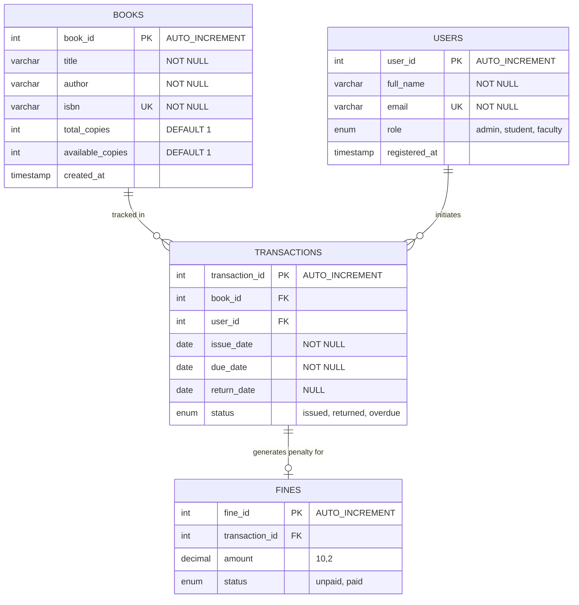

# 🌌 SyntaxShelf-

A high-throughput library catalog blueprint powered by MySQL. Built to push structural database design to its limits, this system manages complex relationships, nested queries, and transactional integrity for a modern digital archive.

---

## 🛠️ Project Intent & Focus
This repository serves as a direct implementation and validation of advanced **Relational Database Design** and **MySQL engine mastery**. The schema handles multi-entity dependencies, prevents structural anomalies, and utilizes indexes to deliver optimized query execution plans.

### Key Database Engineering Practices Implemented:
* **Relational Schema Architecture:** Organized tables under strict 3NF (Third Normal Form) to minimize operational overhead and block modification anomalies.
* **Data Integrity Architecture:** Configured atomic `FOREIGN KEY` constraints paired with cascading structural rules (`ON DELETE RESTRICT`, `ON UPDATE CASCADE`).
* **Query Performance Acceleration:** Applied optimized index fields to reduce disk scan footprints during heavy retrieval tasks.

---

## 📊 Entity-Relationship (ER) Diagram
This system models real-world library operations across four core entities using a relational model. 

*GitHub automatically renders the diagram below:*



---

## 🗄️ Database Schema Blueprint

Below is the structured data definition script configured to spawn your backend layout environment:

```sql
CREATE DATABASE IF NOT EXISTS syntaxshelf_db;
USE syntaxshelf_db;

-- 1. Books Inventory Catalog
CREATE TABLE books (
    book_id INT AUTO_INCREMENT PRIMARY KEY,
    title VARCHAR(255) NOT NULL,
    author VARCHAR(255) NOT NULL,
    isbn VARCHAR(20) UNIQUE NOT NULL,
    total_copies INT DEFAULT 1 CHECK (total_copies >= 0),
    available_copies INT DEFAULT 1 CHECK (available_copies <= total_copies),
    created_at TIMESTAMP DEFAULT CURRENT_TIMESTAMP
) ENGINE=InnoDB;

-- 2. Library User Registry
CREATE TABLE users (
    user_id INT AUTO_INCREMENT PRIMARY KEY,
    full_name VARCHAR(255) NOT NULL,
    email VARCHAR(100) UNIQUE NOT NULL,
    role ENUM('admin', 'student', 'faculty') DEFAULT 'student',
    registered_at TIMESTAMP DEFAULT CURRENT_TIMESTAMP
) ENGINE=InnoDB;

-- 3. Circulation Ledgers (Transaction Tracking)
CREATE TABLE transactions (
    transaction_id INT AUTO_INCREMENT PRIMARY KEY,
    book_id INT NOT NULL,
    user_id INT NOT NULL,
    issue_date DATE NOT NULL,
    due_date DATE NOT NULL,
    return_date DATE DEFAULT NULL,
    status ENUM('issued', 'returned', 'overdue') DEFAULT 'issued',
    FOREIGN KEY (book_id) REFERENCES books(book_id) ON UPDATE CASCADE ON DELETE RESTRICT,
    FOREIGN KEY (user_id) REFERENCES users(user_id) ON UPDATE CASCADE ON DELETE RESTRICT
) ENGINE=InnoDB;

-- 4. Fine Ledger (Financial Accountability)
CREATE TABLE fines (
    fine_id INT AUTO_INCREMENT PRIMARY KEY,
    transaction_id INT NOT NULL,
    amount DECIMAL(10, 2) NOT NULL CHECK (amount >= 0.00),
    status ENUM('unpaid', 'paid') DEFAULT 'unpaid',
    FOREIGN KEY (transaction_id) REFERENCES transactions(transaction_id) ON UPDATE CASCADE ON DELETE CASCADE
) ENGINE=InnoDB;

-- Index Optimization Strategy for Fast Lookups
CREATE INDEX idx_isbn ON books(isbn);
CREATE INDEX idx_user_email ON users(email);
CREATE INDEX idx_transaction_status ON transactions(status);
```

---

## ⚡ Execution Testing Grounds

### Bulk Populating Data via CSV/Python
The application parses raw inventory data using Python engine drivers (`app.py`, `testdbfile.py`), ingestion scripts loop structural items through parameterized statements to prevent injection issues while maintaining schema integrity constraints.

### Core Analytics Testing Queries
To run performance analysis and inspect transactional constraints, execute this query snippet in the MySQL client line interface:

```sql
-- Retrieve active user accounts carrying overdue books along with accrued fine penalties
SELECT 
    u.full_name, 
    u.email, 
    b.title AS borrowed_book, 
    t.due_date, 
    f.amount AS penalty_due
FROM transactions t
JOIN users u ON t.user_id = u.user_id
JOIN books b ON t.book_id = b.book_id
LEFT JOIN fines f ON t.transaction_id = f.transaction_id
WHERE t.status = 'overdue' AND f.status = 'unpaid'
ORDER BY f.amount DESC;
```
